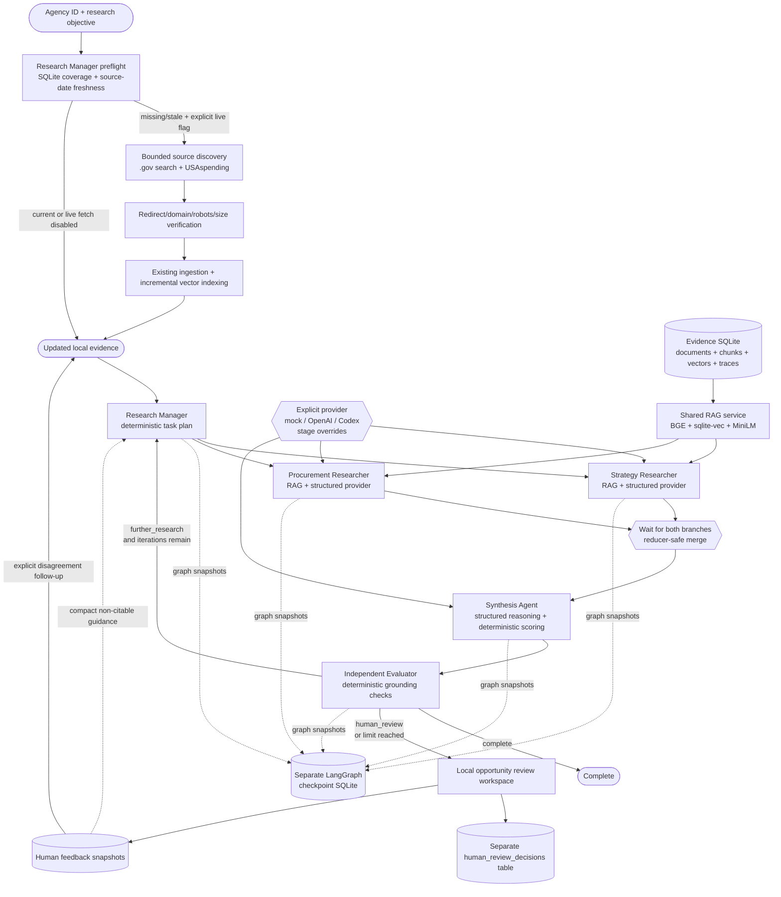
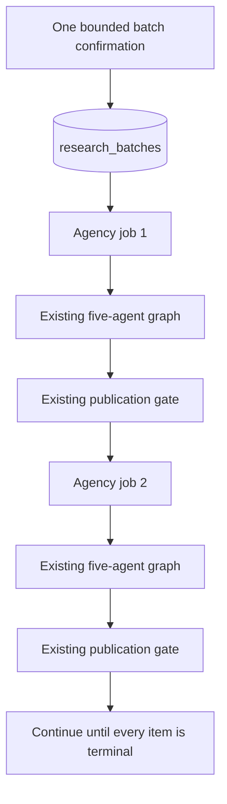

# LangGraph Multi-Agent Foundation

This document explains the working orchestration layer above the RAG MVP. The
manager is deterministic. Strategy, procurement, and synthesis use a
provider-neutral protocol with a safe synthetic mock default, an explicitly
selected LangChain/OpenAI Structured Outputs adapter, and an isolated Codex
subscription adapter. The Independent
Evaluator applies deterministic grounding/business checks. Mock mode requires
no live model; OpenAI mode adds bounded language reasoning over the same compact
evidence. This is not a general autonomous research system.

Synthetic demonstrations remain clearly labeled. Real-agency runs use a
separate database and preserve official URLs/API provenance; mock mode validates
workflow plumbing but is not presented as general reasoning about a real agency.

## Architecture



The graph deliberately separates three kinds of state:

1. The evidence database stores durable agencies, documents, chunks, vectors,
   and retrieval traces. It remains the factual source of truth.
2. LangGraph state stores the current plan, researcher handoffs, synthesis,
   evaluation, and execution events as JSON-compatible values.
3. The checkpoint database stores graph snapshots by `thread_id`. It is local
   orchestration memory, not a source of evidence.
4. The review workspace reads saved terminal JSON plus evidence SQLite, groups
   repeated results by agency/stable opportunity ID, and writes only reviewer
   decisions to a separate table keyed by run/target ID.
5. Human feedback snapshots store reviewer agreement/corrections and the exact
   assessment/evidence fingerprint. They guide future retrieval but never enter
   the evidence or citation tables.

The desktop self-service queue is a sixth, deliberately separate kind of
state. `research_jobs.sqlite3` records whether a bounded CLI execution is
queued, running, cancelling, failed, complete, or awaiting review. A hidden
local worker invokes the unchanged `research-agency` or `run-agent-graph`
entry point, while LangGraph still owns all five agent stages and checkpoint
semantics. The queue is therefore process coordination—not an agent, graph
node, source of evidence, or replacement checkpoint store. The Explorer's
registry switches to a new immutable output only after schema, evaluator,
agency-routing, and citation-resolution checks pass.

Bulk refresh adds a parent authorization record but does not nest or replace
LangGraph. One `batch_worker` schedules ordinary agency jobs sequentially:



Each child has its own evidence database, checkpoint, immutable output, and
normal job status. The batch stores only agency order, action, objective,
aggregate limits/usage, and cancellation/recovery state. Isolated failures and
valid human-review routes continue; shared authentication, security,
infrastructure, or aggregate-budget failures pause before another child starts.

## Functional components versus remaining placeholders

| Component | Status | What it actually does |
|---|---|---|
| Document ingestion and SQLite storage | Functional | Preserves reviewed source text, dates, metadata, hashes, stable IDs, and chunks. |
| BGE embedding and sqlite-vec retrieval | Functional | Incrementally indexes chunks and applies metadata filters before vector top-k. |
| MiniLM reranking and retrieval traces | Functional | Reranks local candidates and saves complete trace JSON. |
| `RAGResearchService` | Functional adapter | Runs the existing retriever per exact document type and returns validated evidence with IDs and traces. |
| LangChain `StructuredTool` | Functional interface | Exposes the same local service to a future tool-using agent; the current researchers call the service directly before mock analysis. |
| Typed LangGraph, parallel join, reducers, routing | Functional orchestration | Executes nodes, merges concurrent branch writes, checkpoints state, loops within a bound, and terminates. |
| Research Manager | Functional deterministic component | Creates transparent fixed strategy/program/budget and procurement assignments; it does not autonomously plan. |
| Evidence compaction | Functional | Selects diverse, deduplicated excerpts under separate Strategy and Procurement context budgets while retaining IDs, dates, ranks, and traces. |
| Strategy Researcher | Functional mock + OpenAI + Codex | Extracts cited mission priorities, operational needs, and budget evidence through the selected structured provider. |
| Procurement Researcher | Functional mock + OpenAI + Codex | Extracts cited RFP, intent/confirmed status, scope, vendor, and date findings without equating intent with execution. |
| Synthesis Agent | Functional mock + OpenAI + Codex | Merges supported findings through the provider, then reapplies four transparent score factors and ranking in Python. |
| OpenAI structured-model adapter | Functional, opt-in | Uses LangChain `ChatOpenAI`, the Responses API, and Pydantic schemas. It is constructed only after `--model-provider openai`; tests inject a fake provider. |
| Codex structured-model adapter | Functional, opt-in; bounded live validation completed | Uses official `openai-codex`, an ephemeral empty workspace, read-only sandbox, denied approvals, disabled known tools/MCP, Pydantic schema validation, and existing ChatGPT/Codex login. Offline tests inject a fake turn runner. |
| Stage provider router | Functional | Applies Strategy/Procurement/Synthesis overrides before the global provider and shares the existing workflow budget without changing graph nodes. |
| Independent Evaluator | Functional deterministic component | Checks citations, evidence sufficiency, chronology, contradictions, rank/score consistency, and unsupported commercial claims. |
| Local opportunity-review workspace | Functional local UI | Shows unique real-model opportunities, retains older run history, resolves complete SQLite evidence/traces, displays rejected procurement records, separates opportunity and run-wide concerns, and persists reviewer decisions separately. |
| Human feedback memory | Functional deterministic component | Stores Agree/Disagree snapshots in SQLite, reuses unchanged agreement, flags changed evidence, and supplies at most three non-citable guidance records to later runs. |
| Targeted feedback follow-up | Functional explicit action | Runs one bounded existing graph cycle over local evidence; mock is default and OpenAI requires explicit paid authorization. |
| Architecture & execution visualization | Functional read-only UI | Uses Graphviz DOT to show the implemented graph and trace-derived activity for a selected saved run; it never calls agents or reconstructs missing events. |
| Call/token budget | Functional | Rejects exhausted budgets before provider execution and converts exhaustion into a structured human-review result. |
| Legacy agent-tool web boundary | Interface only | `ExternalResearchProvider` remains unavailable; current live research is the deterministic pre-graph pipeline below, not an agent tool. |

The older `ExternalResearchProvider` remains an unused future tool boundary.
Milestone 3 adds a working deterministic pre-graph pipeline instead of placing
network access inside either researcher or a ReAct loop:

| Web component | Status | What it actually does |
|---|---|---|
| `GovernmentWebsiteAdapter` | Functional, opt-in | Uses Brave Search when configured, filters to one approved `.gov` domain, and stores candidates only. Seed URLs work without a search key. |
| `USAspendingAdapter` | Functional, opt-in | Queries documented prime contract types A--D, maps award/vendor/date/value/scope fields, and emits sanitized HTTP diagnostics without retaining bodies or headers. |
| `SafeWebFetcher` | Functional, opt-in | Validates HTTPS domains and resolved addresses, checks robots.txt, validates every redirect, retries transient responses, and enforces URL/byte/runtime bounds. |
| Discovery SQLite tables | Functional | Store runs, candidates, provenance, failures, hashes, and ingestion status separately from verified documents. |
| `research-agency` preflight | Functional | Checks missing/stale categories, optionally discovers/ingests/indexes, then invokes the unchanged five-node graph. |
| SAM.gov, state/local, UK adapters | Extension points only | No network implementation exists yet. They should emit the same discovered-source facts and pass through the same verification/ingestion boundary. |

## Security and quality boundaries

External files cross two deterministic checks before becoming evidence.
`SafeWebFetcher` verifies the approved HTTPS destination, public address,
redirects, robots policy, byte/runtime allowances, declared content type, and
actual byte signature. `DocumentIngestor` repeats signature validation for
local/API paths, uses a local ClamAV scanner only when it is installed, applies
bounded parsing limits, redacts credential-shaped values, and stores
category-only suspicious-content indicators in document metadata. Executables,
archives, type mismatches, unexpected binary data, malware findings, ambiguous
scanner failures, and malformed documents never reach chunks or vectors.

Model-visible evidence is explicitly labeled `untrusted_external_evidence`.
Provider instructions forbid embedded text, URLs, titles, or metadata from
changing roles, tools, permissions, providers, schemas, or workflows. Codex
still runs in a new empty read-only directory with denied approvals and the
reviewed tool/MCP/network features disabled. This deterministic isolation—not
the model's judgment—is the primary prompt-injection defense.

The Independent Evaluator verifies that citations remain in the selected
agency partition, records suspicious-content warnings, distinguishes retrieved
evidence from excerpts handed to researchers and citations used in findings,
and routes material context omissions to human review. Warnings alone do not
invalidate legitimate government facts. The Architecture & Execution view
shows a sanitized Security & Quality summary without raw suspicious text,
secrets, headers, or private paths.

The existing OpenAI opportunity assessment remains a separate CLI path. Mock
graph mode does not invoke either OpenAI path or read an API key.

## Shared graph state

`agents/state.py` defines `ResearchGraphState`, a `TypedDict`. `total=False`
allows each node to return only the fields it changes.

| Field | Owner / meaning |
|---|---|
| `agency_id`, `objective` | Immutable run inputs supplied by the user. |
| `as_of_date` | Optional historical evidence eligibility cutoff. |
| `freshness_cutoff_date` | Optional labeling threshold; it does not filter evidence. |
| `max_iterations`, `iteration` | Bounded loop configuration and current cycle. |
| `thread_id` | Identity used by the LangGraph checkpoint saver. |
| `prior_human_feedback` | Small deterministic guidance list; never source evidence or a valid citation. |
| `tasks` | Current manager assignments. |
| `researcher_outputs` | Reducer-managed history from both parallel branches. |
| `model_calls` | Reducer-managed provider/model identities and per-agent token counts. |
| `max_agent_calls`, `max_agent_input_tokens`, `max_agent_output_tokens` | Workflow-wide safety budgets; defaults are 6 calls, 50,000 cumulative input tokens, and 6,000 cumulative output tokens. |
| `synthesis` | Current consolidated evidence catalog. |
| `evaluation`, `route` | Current structural checks and conditional decision. |
| `execution_trace` | Reducer-managed, stable event records. |
| `final_result` | Schema-validated terminal output returned to the CLI. |

### Why reducers are required

Strategy and procurement nodes execute in the same graph step. If both wrote a
normal list field, concurrent updates could conflict or one update could be
lost. `merge_researcher_outputs()` uses `(iteration, role)` as a stable key.
`merge_trace_events()` uses `event_id`. This preserves both branches and makes
checkpoint retries idempotent.

The graph also uses:

```python
builder.add_edge(
    ["strategy_researcher", "procurement_researcher"],
    "synthesis_agent",
)
```

The list of source nodes is a join barrier: synthesis runs only after both
researchers finish.

The researcher nodes are scheduled in parallel, but the shared service guards
its BGE/MiniLM/sqlite-vec critical section with a process-local lock. The local
model wrappers and incremental vector index are shared mutable resources; this
prevents duplicate first-loads and competing index initialization. A future
deployment with separate worker/model instances can replace this local safety
choice without changing the graph contracts.

## Agent contracts

`agents/contracts.py` uses strict Pydantic models so extra fields are rejected.
Every node validates inputs from state and emits a JSON-serializable dictionary.

- `ResearchTask` is the manager-to-researcher assignment.
- `EvidenceRecord` is the complete result used only inside retrieval/researcher boundaries.
- `EvidenceReference` is the bounded excerpt, IDs, dates, rank, and trace passed downstream.
- `ResearchEvidenceBatch` is the shared RAG service response.
- `ResearchFinding` is one typed fact with chunk/document citations.
- `ResearcherOutput` is one branch's compact evidence, findings, and gaps.
- `OpportunityCandidate` separates documented facts, inferences, commercial implications, uncertainties, procurement status, explicit sales-readiness classification, the backward-compatible actionability boolean, and factor scores.
- `SynthesisOutput` is the merged evidence/finding catalog and ranked candidates.
- `EvaluationOutput` records all deterministic checks and one route.
- `ModelCallRecord` and `BudgetSummary` expose call/token consumption.
- `TraceEvent` is a compact, deterministic workflow event.
- `ResearchGraphResult` is the saved and printed terminal schema.

These contracts are the main compatibility boundary. Future agents may change
their internal prompts, models, or tool loops while preserving the handoff
shapes used by downstream nodes and tests.

## LangChain, LangGraph, and RAG interaction

LangGraph controls *when* nodes run, what state they read/write, how parallel
updates merge, and where evaluation routes next. It does not perform retrieval.

LangChain supplies `StructuredTool`, a typed tool boundary around
`RAGResearchService.research()`. Researchers call the service directly because
this is easier to inspect and test. Separately, `ChatOpenAI` implements the
optional structured reasoning boundary. A future ReAct agent can bind
`search_local_evidence` without rewriting the retrieval pipeline.

The existing RAG modules still perform the substantive evidence work:

```text
researcher node
  -> RAGResearchService.research()
     -> SemanticRetriever.retrieve() once per exact document type
        -> VectorIndexer.sync()
        -> SQLiteStore.semantic_candidates() with pre-top-k filters
        -> local cross-encoder reranking
        -> SQLiteStore.save_retrieval_trace()
  -> EvidenceRecord[] held briefly inside the researcher
  -> EvidenceReference[] + ResearchFinding[] in graph state
```

`evidence.compact_strategy_evidence()` performs that conversion for Strategy.
It keeps focused 800-character excerpts, removes duplicates, caps chunks per
document, preserves category/source diversity, and applies a configurable
2,000--4,000-token aggregate allowance. Procurement instead uses
`evidence.compact_procurement_evidence()`: complete short RFP/intent/award
chunks are preserved under a configurable 2,000--4,000-token aggregate budget,
and fact-rich chunks are preferred when a longer retrieved set does not fit.
The function removes exact duplicate passages and remains extractive, so every
excerpt still belongs to its original stable chunk citation. Complete durable
text remains in SQLite; no extra retrieval stage or model call is introduced.

Procurement retrieval intentionally separates search wording from reasoning
wording. `build_procurement_retrieval_query()` converts the full objective into
one bounded contract/scope query using the same controlled modernization terms
as official-source discovery. BGE and MiniLM receive the concise query; the
Procurement model still receives the original objective unchanged. This avoids
cross-encoder dilution from long instructional caveats while every retrieval
trace preserves the exact query, original vector ranks, and reranker scores.

For strategy, budget, and program-plan categories, semantic retrieval adds a
small relational supplement when current major documents are absent from
vector top-20. Explicit stored dates select at most one Strategy/Budget and two
Program documents; fiscal years in titles never become publication dates.
Their best query-overlap chunks still pass through MiniLM and are marked
`retrieval_method=metadata_supplement` while original semantic ranks/scores
remain in the trace.

Searching each requested document type separately is intentional. The existing
sqlite-vec query applies agency, type, and historical date predicates inside
the vector query. Filtering a mixed result list afterward could let ineligible
chunks consume the limited candidate slots.

## Conditional routing and stopping

The deterministic evaluator chooses:

- `complete` when both branches are present and citation, sufficiency,
  chronology, contradiction, scoring, and commercial-claim checks pass;
- `further_research` when categories are missing and another configured cycle
  remains; or
- `human_review` when structural validation fails or gaps remain at the limit.

The Research Manager is the only node that increments `iteration`. The runner
also sets a LangGraph recursion limit derived from `max_iterations`. These two
guards prevent an unbounded research loop.

The evidence database cannot change inside one graph invocation. A later cycle
therefore reuses prior researcher output, and synthesis reuses its result when
the evidence/finding IDs are unchanged. A budget rejection stores a sanitized
`BudgetExceededDiagnostic`, preserves retrieved citations, and routes through
deterministic evaluation to `human_review`.

Missing local evidence never proves that a public record or contract does not
exist. A human-review route means the local corpus is insufficient for this
plan; it is not a factual conclusion about the outside world.

## Architecture and saved-execution visualization

The Streamlit sidebar exposes **Architecture & Execution** alongside the
existing Opportunity Review workspace. Its Architecture tab is a direct visual
translation of `build_research_graph()`: the manager fans out to Strategy and
Procurement, the list-edge join waits for both, Synthesis feeds the deterministic
Evaluator, and conditional routes lead to Complete, Human Review, or another
bounded manager iteration. Local evidence/RAG, government sources, and human
feedback memory are supporting boxes rather than extra agents. LLM-backed nodes
use one color; deterministic and human components use distinct restrained colors.

The visual layout is top-to-bottom rather than execution-order left-to-right.
This is a presentation choice only: Strategy and Procurement remain one
parallel rank, all implemented handoff edges remain visible, and the bounded
further-research route still loops from Evaluator to Manager. The compact
sidebar defaults to Architecture & Execution and uses native buttons, while a
centralized light theme controls typography and spacing without altering graph
or review state.

The Execution tab reads a validated saved `ResearchGraphResult`. It derives:

- node activity and evaluator routes from `execution_trace`;
- evidence and structured-finding counts from `researcher_outputs`;
- calls and provider-reported/estimated token usage from `model_calls`;
- failures from `budget_exceeded`; and
- final outcome and evaluator reasons from `status` and `evaluation`.

No diagram rendering calls LangGraph, RAG, OpenAI, or a network source. Parallel
branches are shown side by side because the current result records do not carry
their completion order. Node start/end timestamps, durations, and the checkpoint
database path/snapshots are also not embedded in the result, so the dashboard
labels them as unavailable instead of inferring them. A provider call is counted
inside a stage but is never presented as the whole agent iteration.

The localhost Streamlit workspace begins after this terminal route. It does not
become a sixth agent or graph node. It scans saved `ResearchGraphResult` JSON,
keeps mock/demo runs outside the active business queue, and groups repeated
real-model results only when agency and stable opportunity IDs both match. The
newest result is primary; older versions and prior decisions remain visible.
Changed cited/procurement evidence triggers reassessment rather than silently
resetting or carrying an earlier decision. Cited chunks resolve through the
evidence database and retrieval traces. Reviewer decisions are stored in
`human_review_decisions`; approval means permission for further human-led sales
research, not confirmation that an acquisition is open or unawarded.

Agreement/disagreement is stored separately from the sales-review decision. An
agreement can suppress an identical repeated review only when the full saved
assessment, evaluator result, cited source IDs/dates, and procurement evidence
fingerprint are unchanged. New evidence or conclusions require reassessment.
Disagreement requires a correction and enables one explicit follow-up. The
correction focuses the manager/researcher query but cannot be cited; normal
citation integrity and evaluator rules remain unchanged.

Procurement records carry a deterministic `relevant`, `unrelated`, or
`unknown` scope label. Only a positive MiniLM score plus explicit objective
scope overlap counts as relevant; only relevant confirmed awards can establish
awarded scope. Missing RFP/intent stages remain visible `coverage_gaps` rather
than blocking a sufficiently supported executed award by themselves.

## Bounded source refresh before LangGraph

`research_manager.plan_source_discovery()` reads the existing relational
documents before graph execution. For each strategy, budget, program-plan,
RFP, intent, and confirmed-award category, it labels coverage missing, current,
or stale. Freshness uses last-updated, publication, then effective date; capture
date is never substituted for an unknown source date.

Discovery derives at most four controlled procurement phrases from the stated
objective and stored strategy/budget/program evidence. Official-site templates
use them, while USAspending makes one broad query plus at most three keyword
queries. Broad results preserve nonmatching awards, stable source IDs
deduplicate matches, and known awarding subagencies can supplement the top-tier
agency identifier.

When `research-agency` receives `--allow-live-fetch`, the CLI performs this
deterministic sequence before constructing the graph:

```text
plan_source_discovery()
  -> discover_sources()
     -> GovernmentWebsiteAdapter (Brave or explicit seed URLs)
     -> USAspendingAdapter (public API, no key)
  -> discovered_sources rows (not yet evidence)
  -> ingest_discovered_sources()
     -> SafeWebFetcher for approved website sources
     -> DocumentIngestor.ingest_bytes()
  -> VectorIndexer.sync()
  -> unchanged run_offline_research_graph()
```

Search snippets never become chunks. USAspending structured records may be
ingested directly because the API response is the official source record.
Website pages called confirmed awards are rejected unless explicit contract
ID, vendor, and execution-date metadata exists. A failed search/fetch remains
a stored coverage gap and cannot support an absence claim.

## Structured-model provider boundary

`StructuredAgentModel` declares exactly three calls: strategy analysis,
procurement analysis, and synthesis. `SyntheticMockAgentModel` remains the
default implementation. `OpenAIStructuredAgentModel` implements the same
protocol with a LangChain-compatible model and JSON-schema Structured Outputs.
`CodexStructuredAgentModel` implements that protocol with the official Codex
Python SDK. `StageRoutedAgentModel` selects one adapter per operation, so a
hybrid run remains one unchanged graph with one shared call/token budget.

Provider resolution is: stage-specific setting, then global setting, then the
safe `mock` default. The saved workflow provider is `mixed` when stage choices
differ; every model-call record stores its actual provider and model. No
adapter falls back to another provider.

Each call is isolated:

1. The researcher retrieves only its assigned document types.
2. The role-specific evidence compactor creates bounded excerpts with stable
   IDs and dates. Strategy remains sentence-focused; Procurement preserves
   complete short records and prioritizes status/vendor/date/value/scope text.
3. The provider sees only the research objective and those role-specific records.
4. Pydantic validates the response.
5. The node rejects citations outside the supplied allow-list.
6. Synthesis sees compact evidence and validated findings from both branches,
   but no unrelated documents or conversation histories. A complete short
   procurement record is allowed only within its dedicated context budget.
7. Python reapplies the four existing score factors and ordering.
8. The deterministic evaluator checks status, evidence, chronology, claims,
   chunk-to-document relationships, exact identifiers/dates, and conservative
   excerpt support. Semantic uncertainty routes to human review.

The fixed synthetic mock runs only when every supplied source is explicitly
labeled synthetic or fictional. On unfamiliar real-agency evidence it returns
no findings; missing findings are insufficient evidence, not proof of absence.
When a freshness cutoff is supplied, current evidence is handed to researchers
before older or undated evidence while original retrieval ranks remain in the
trace.

## Milestone 3.1 metadata refresh

`refresh_existing_agency_metadata()` repairs existing rows from stored title,
URL, and text without downloading them again. It accepts explicit date labels
only, preserves unknown values, and updates the discovery ledger. When type or
date metadata changes, the store deletes only that document's vec0 rows because
sqlite-vec duplicates those fields for pre-top-k filtering. The next incremental
index sync recreates them from unchanged chunks and stable IDs.

Mock is the CLI default. OpenAI construction requires the explicit
`--model-provider openai` flag; there is no paid fallback. Hidden LangChain
retries are disabled so one graph call record maps to one provider attempt.
Call/input allowances are reserved before a request, and provider token usage
is recorded when returned.

The Responses API supports only a subset of JSON Schema in strict mode.
`openai_model._openai_output_schema()` therefore removes Pydantic-generated
`minLength` and `maxLength` from the provider request while retaining the
original Pydantic model for local response validation and places `strict: true`
inside the manual `text.format` object. The adapter follows LangChain's wrapper
cause chain and emits sanitized provider diagnostics containing only stage,
HTTP status, error code/type, parameter, and a redacted short message. It does
not serialize prompts, request bodies, headers, or credentials. The separate
`diagnose-openai-structured` command makes one bounded request with fixed text
and a tiny schema so model/account/endpoint compatibility can be tested without
LangGraph, RAG, SQLite, or project evidence.

### Codex model-only boundary

Codex runs in a fresh empty temporary directory, not the research repository.
Each thread is ephemeral, uses the read-only sandbox, denies approval prompts,
and receives explicit app-server overrides that disable web search, MCP
servers, shell/unified execution, apps, plugins, multi-agent, browser,
computer-use, image, and related tool surfaces. Evidence is supplied directly
as JSON input. The adapter reuses the same substantive prompts, Pydantic
schemas, citation validators, deterministic scoring, and evaluator.

The adapter reuses the active Codex home and supported login. It never opens or
copies credential files and does not require `OPENAI_API_KEY`. Existing
`CODEX_HOME`, `CODEX_CA_CERTIFICATE`, and `SSL_CERT_FILE` settings are inherited;
TLS verification is never disabled. `check-codex-readiness` starts app-server
and an empty secure thread without submitting a turn, distinguishing transport
and login readiness from successful inference.

A read-only sandbox alone does not disable agent tools. Security also depends
on the installed SDK/app-server honoring the explicit feature and MCP
overrides. Unknown future tool features are not automatically covered;
approval denial and the isolated empty workspace provide additional fail-closed
boundaries. The explicitly authorized 2026-11-17 Gates A--C validated
subscription login, structured output, all three agent calls, citations, and a
repeat fixture with `gpt-6.1-sol`. Strategy was stable. Procurement was
substantively complete but one statement ended with a truncated partial word.
Synthesis was grounded and correctly classified awarded versus non-actionable
scope, but its narrative mentioned an incorrect score scale before Python
applied the correct 0--3 factors. These are quality limitations, not schema or
citation failures.

## Local checkpointing

`run_offline_research_graph()` opens `SqliteSaver` with a separate SQLite
connection and compiles the graph with that saver. Every invocation uses a
`thread_id`; the CLI generates a new one unless the user supplies it. The
connection closes in a `finally` block.

The default path is `data/langgraph_checkpoints.sqlite3`, configured by
`LANGGRAPH_CHECKPOINT_PATH`. Database files are ignored by Git. SQLite
checkpointing is appropriate for a local demonstration and small synchronous
projects; it is not the production choice for a concurrent multi-user service.

## How to extend each provider or deterministic component

### Research Manager

Keep `ResearchTask` as the output. Add a schema-constrained planning model that
selects research categories from an allowed taxonomy. Validate the plan before
fan-out, cap task count, and record why each task is needed. Do not let a model
invent agency IDs or silently expand scope.

### Strategy Researcher

The OpenAI adapter supplies structured extraction behind
`StructuredAgentModel`. Evaluate its prompts against reviewed labels before a
later bounded ReAct loop binds `RAGResearchService.as_langchain_tool()`. The
current source adapters already route verified content through normal ingestion
before it becomes durable evidence; do not expose raw search snippets as tools.

### Procurement Researcher

Add deterministic procurement entity queries alongside semantic retrieval and
evaluate live extraction against reviewed labels. Preserve `intent-to-award`
versus `confirmed-award` and normalize contracts, vendors, amendments, and
dates before allowing status conclusions.

### Synthesis Agent

The live adapter starts from the compact deduplicated evidence/finding catalog,
requires citation IDs, separates facts from inferences, and reapplies scoring
in Python. Next, add entailment evaluation and retain contradictions rather
than resolving them silently. Add buying-persona schemas only after evaluation
criteria exist.

### Independent Evaluator

The current evaluator already applies deterministic citation allow-lists,
status-specific evidence sufficiency, structured-date chronology, declared
contradiction, score/rank, and unsupported-commercial-phrase rules. A future
version should add semantic entailment and broader evidence-coverage rubrics
while remaining independent from the synthesizer's prompt/model configuration.
A failed evaluation should produce more targeted follow-up tasks than the
current fixed manager plan, not a vague loop.

The sales-readiness policy does not require a known open RFP or committed
funding before identifying a *potential* lead. It does require a specific cited
operational need, plausible solution fit, and a meaningful Procurement review.
A no-match result always warns that reviewed sources do not prove contract
absence. Confirmed solicitations receive a separate readiness label. Executed
relevant scope is `already_awarded` unless cited evidence identifies a residual
requirement or credible expansion path; `partially_addressed` cannot be used
merely because future gaps are imaginable. These checks leave the existing
0--3 scoring factors unchanged.

### Human review

The working localhost opportunity workspace stores explicit decisions in
`human_review_decisions`, separate from evidence and original agent output.
It does not yet resume a paused graph or convert reviewer notes into evidence.
Connect decisions to graph interrupts only after the resume policy is designed;
human comments must never become verified facts automatically.

## Recommended development sequence

1. Evaluate live extraction/synthesis on a larger reviewed corpus; keep mock mode as the reproducible default.
2. Normalize procurement entities and deterministic contract/amendment queries.
3. Add semantic entailment and evidence-coverage checks to the evaluator.
4. Upgrade manager planning using evaluator gap records.
5. Add human interrupt/resume behavior and reuse the existing review storage.
6. Add reviewed SAM.gov/state/local/UK adapters through the existing discovery
   and safe-ingestion boundary; never make raw search snippets durable evidence.
7. Evaluate persistent cross-run
   research memory or production checkpoint infrastructure.

The next component should be a labeled evaluation set for live structured
researcher and synthesis output. The deterministic evaluator and budgets remain
mandatory. Unrestricted crawling and autonomous browser/tool loops remain
outside scope.
