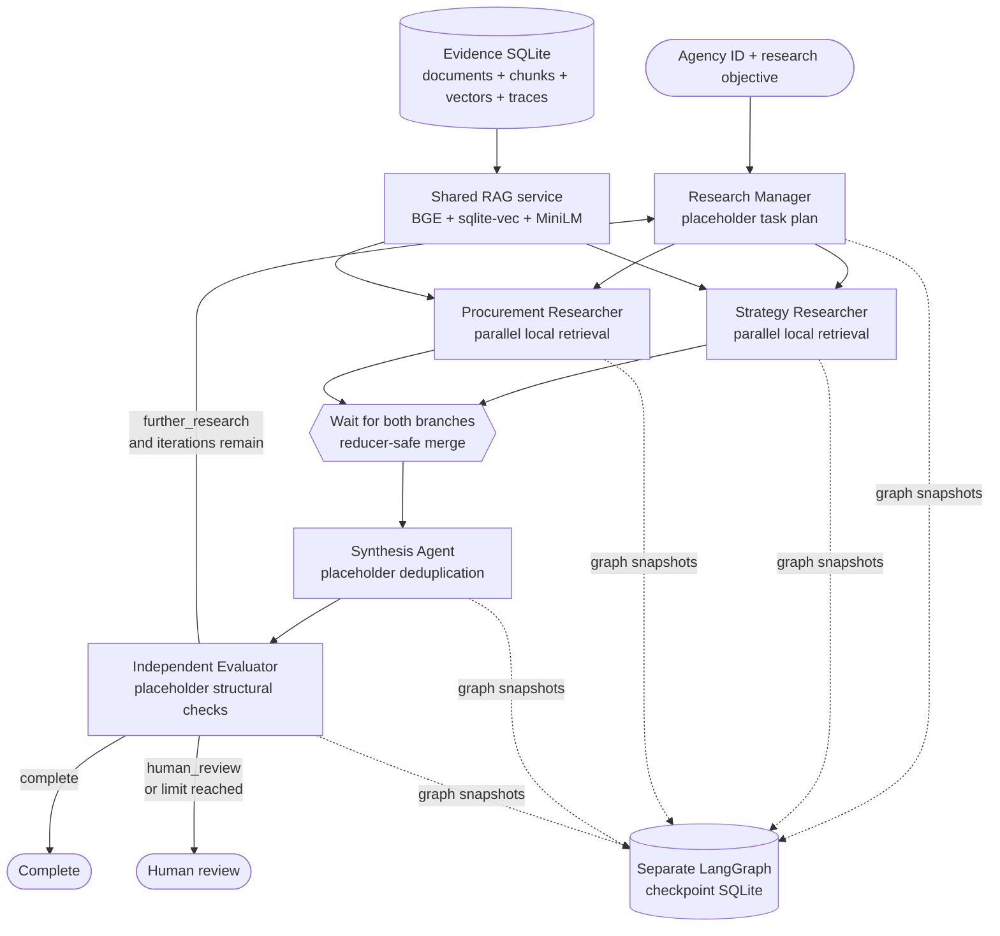

# LangGraph Multi-Agent Foundation

This document explains the orchestration layer added above the working RAG
MVP. The graph is functional, but the five role implementations are
deterministic placeholders. They retrieve and organize real local evidence;
they do not perform autonomous reasoning, live web research, or commercial
opportunity analysis.

All sample evidence remains synthetic. A graph run must not be presented as a
finding about a real agency or vendor.

## Architecture



The graph deliberately separates three kinds of state:

1. The evidence database stores durable agencies, documents, chunks, vectors,
   and retrieval traces. It remains the factual source of truth.
2. LangGraph state stores the current plan, researcher handoffs, synthesis,
   evaluation, and execution events as JSON-compatible values.
3. The checkpoint database stores graph snapshots by `thread_id`. It is local
   orchestration memory, not a source of evidence.

## Functional components versus placeholders

| Component | Status | What it actually does |
|---|---|---|
| Document ingestion and SQLite storage | Functional | Preserves reviewed source text, dates, metadata, hashes, stable IDs, and chunks. |
| BGE embedding and sqlite-vec retrieval | Functional | Incrementally indexes chunks and applies metadata filters before vector top-k. |
| MiniLM reranking and retrieval traces | Functional | Reranks local candidates and saves complete trace JSON. |
| `RAGResearchService` | Functional adapter | Runs the existing retriever per exact document type and returns validated evidence with IDs and traces. |
| LangChain `StructuredTool` | Functional interface | Exposes the same local service to a future tool-using agent; the placeholder graph calls the service directly. |
| Typed LangGraph, parallel join, reducers, routing | Functional orchestration | Executes nodes, merges concurrent branch writes, checkpoints state, loops within a bound, and terminates. |
| Research Manager | Placeholder | Creates two transparent fixed assignments; it does not autonomously plan. |
| Strategy Researcher | Placeholder | Retrieves strategy and budget passages; it does not interpret priorities. |
| Procurement Researcher | Placeholder | Retrieves RFP/intent/confirmed-award passages; it does not decide award status. |
| Synthesis Agent | Placeholder | Deduplicates chunk IDs and records coverage; it does not prioritize opportunities or map personas. |
| Independent Evaluator | Placeholder | Checks branch/category/citation structure and iteration limits; it does not judge factual entailment or commercial quality. |
| Live public-source research | Interface only | `ExternalResearchProvider` defines a future boundary; the provided implementation always reports unavailable. |

The existing OpenAI opportunity assessment remains a separate, working CLI
path. The offline graph does not invoke it and does not read an API key.

## Shared graph state

`agents/state.py` defines `ResearchGraphState`, a `TypedDict`. `total=False`
allows each node to return only the fields it changes.

| Field | Owner / meaning |
|---|---|
| `agency_id`, `objective` | Immutable run inputs supplied by the user. |
| `as_of_date` | Optional historical evidence eligibility cutoff. |
| `freshness_cutoff_date` | Optional labeling threshold; it does not filter evidence. |
| `max_iterations`, `iteration` | Bounded loop configuration and current cycle. |
| `thread_id` | Identity used by the LangGraph checkpoint saver. |
| `tasks` | Current manager assignments. |
| `researcher_outputs` | Reducer-managed history from both parallel branches. |
| `synthesis` | Current consolidated evidence catalog. |
| `evaluation`, `route` | Current structural checks and conditional decision. |
| `execution_trace` | Reducer-managed, stable event records. |
| `final_result` | Schema-validated terminal output returned to the CLI. |

### Why reducers are required

Strategy and procurement nodes execute in the same graph step. If both wrote a
normal list field, concurrent updates could conflict or one update could be
lost. `merge_researcher_outputs()` uses `(iteration, role)` as a stable key.
`merge_trace_events()` uses `event_id`. This preserves both branches and makes
checkpoint retries idempotent.

The graph also uses:

```python
builder.add_edge(
    ["strategy_researcher", "procurement_researcher"],
    "synthesis_agent",
)
```

The list of source nodes is a join barrier: synthesis runs only after both
researchers finish.

The researcher nodes are scheduled in parallel, but the shared service guards
its BGE/MiniLM/sqlite-vec critical section with a process-local lock. The local
model wrappers and incremental vector index are shared mutable resources; this
prevents duplicate first-loads and competing index initialization. A future
deployment with separate worker/model instances can replace this local safety
choice without changing the graph contracts.

## Agent contracts

`agents/contracts.py` uses strict Pydantic models so extra fields are rejected.
Every node validates inputs from state and emits a JSON-serializable dictionary.

- `ResearchTask` is the manager-to-researcher assignment.
- `EvidenceRecord` is a complete attributed retrieval result, including source
  and chunk IDs, dates, ranks, scores, trace ID, and a freshness label.
- `ResearchEvidenceBatch` is the shared RAG service response.
- `ResearcherOutput` is one branch's evidence and missing categories.
- `SynthesisOutput` is a deduplicated evidence catalog plus explicit empty
  placeholder fields for opportunity priorities and buying personas.
- `EvaluationOutput` records structural checks and one route.
- `TraceEvent` is a compact, deterministic workflow event.
- `ResearchGraphResult` is the saved and printed terminal schema.

These contracts are the main compatibility boundary. Future agents may change
their internal prompts, models, or tool loops while preserving the handoff
shapes used by downstream nodes and tests.

## LangChain, LangGraph, and RAG interaction

LangGraph controls *when* nodes run, what state they read/write, how parallel
updates merge, and where evaluation routes next. It does not perform retrieval.

LangChain supplies `StructuredTool`, a typed tool boundary around
`RAGResearchService.research()`. The current placeholders call the service
directly because deterministic code is easier to inspect and test. A future
ReAct agent can bind `search_local_evidence` to a supported chat model without
rewriting the retrieval pipeline.

The existing RAG modules still perform the substantive evidence work:

```text
researcher node
  -> RAGResearchService.research()
     -> SemanticRetriever.retrieve() once per exact document type
        -> VectorIndexer.sync()
        -> SQLiteStore.semantic_candidates() with pre-top-k filters
        -> local cross-encoder reranking
        -> SQLiteStore.save_retrieval_trace()
  -> EvidenceRecord[] in graph state
```

Searching each requested document type separately is intentional. The existing
sqlite-vec query applies agency, type, and historical date predicates inside
the vector query. Filtering a mixed result list afterward could let ineligible
chunks consume the limited candidate slots.

## Conditional routing and stopping

The placeholder evaluator chooses:

- `complete` when both branches are present, role citations resolve to the
  consolidated evidence catalog, and every requested local category returned
  evidence;
- `further_research` when categories are missing and another configured cycle
  remains; or
- `human_review` when structural validation fails or gaps remain at the limit.

The Research Manager is the only node that increments `iteration`. The runner
also sets a LangGraph recursion limit derived from `max_iterations`. These two
guards prevent an unbounded placeholder loop.

Missing local evidence never proves that a public record or contract does not
exist. A human-review route means the local corpus is insufficient for this
plan; it is not a factual conclusion about the outside world.

## Local checkpointing

`run_offline_research_graph()` opens `SqliteSaver` with a separate SQLite
connection and compiles the graph with that saver. Every invocation uses a
`thread_id`; the CLI generates a new one unless the user supplies it. The
connection closes in a `finally` block.

The default path is `data/langgraph_checkpoints.sqlite3`, configured by
`LANGGRAPH_CHECKPOINT_PATH`. Database files are ignored by Git. SQLite
checkpointing is appropriate for a local demonstration and small synchronous
projects; it is not the production choice for a concurrent multi-user service.

## How to replace each placeholder

### Research Manager

Keep `ResearchTask` as the output. Add a schema-constrained planning model that
selects research categories from an allowed taxonomy. Validate the plan before
fan-out, cap task count, and record why each task is needed. Do not let a model
invent agency IDs or silently expand scope.

### Strategy Researcher

Bind `RAGResearchService.as_langchain_tool()` to a tool-capable model. Add a
small ReAct loop with an explicit step budget and grounding rules. A later live
provider may return candidate URLs, but reviewed sources should enter normal
ingestion before becoming durable evidence.

### Procurement Researcher

Add deterministic procurement entity queries alongside semantic retrieval.
Preserve `intent-to-award` versus `confirmed-award` and normalize contracts,
vendors, amendments, and dates before allowing status conclusions.

### Synthesis Agent

Start from the deduplicated `EvidenceRecord` catalog. Require every documented
fact to cite allowed document/chunk IDs, label model inferences separately, and
retain contradictions rather than resolving them silently. Add opportunity
priority and buying-persona schemas only after evaluation criteria exist.

### Independent Evaluator

Add evidence coverage rubrics, entailment/citation tests, chronology checks,
contradiction detection, and commercial-whitespace rules. Keep it independent
from the synthesizer's prompt/model configuration where practical. A failed
evaluation should produce targeted follow-up tasks, not a vague loop.

### Human review

Connect the existing `human_reviews` table to graph interrupts only after the
review interaction and resume policy are designed. Human comments must remain
separate from verified evidence and should not become facts automatically.

## Recommended development sequence

1. Strengthen the Independent Evaluator with a transparent coverage rubric and
   targeted gap output. It provides stopping criteria for every later agent.
2. Normalize procurement entities and deterministic contract/amendment queries.
3. Replace the Procurement Researcher placeholder with bounded tool use.
4. Replace the Strategy Researcher placeholder with bounded tool use.
5. Implement grounded synthesis with fact/inference separation and citation
   validation copied from the existing opportunity assessment.
6. Upgrade manager planning using evaluator gap records.
7. Add human interrupt/resume behavior and reuse the existing review storage.
8. Add a reviewed live-source provider and ingestion queue; do not allow raw
   search snippets to become durable evidence automatically.
9. Evaluate on a larger labeled corpus before adding persistent cross-run
   research memory or production checkpoint infrastructure.

The recommended next component is the evaluator rubric because autonomous
research should not be expanded until the system can say what evidence is
missing, why another iteration is justified, and when it must stop.
